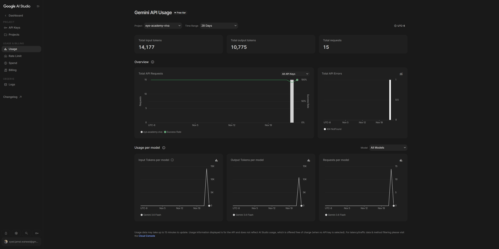

# Eye Academy — Voice Viva Take-Home Write-Up

## 1. Repository & Run Instructions

- **Repository:** `https://github.com/SyedJamal030/eye-academy-viva`
- **Tech Stack:** TanStack Start, Firebase Auth & Firestore, React-Bootstrap, Gemini (`gemini-3.6-flash`), and Browser Web Speech APIs (`SpeechRecognition` / `speechSynthesis`).

### Local Setup & Run

1. Install dependencies:

   ```bash
   npm install
   ```

2. Copy `.env.example` to `.env` (and `.dev.vars` if your local runtime reads it) and fill in your values:
   - Firebase client / auth configuration keys
   - `GEMINI_API_KEY`
   - `VITE_GEMINI_MODEL=gemini-3.6-flash`

3. Start the local dev server:
   ```bash
   npm run dev
   ```

_(If running on Windows PowerShell and encountering process-teardown or shell issues, run `npx vite dev --port 3000` directly and verify no orphaned `workerd.exe` or `node.exe` processes remain.)_

### What Works & Where I Stopped (4-Hour Scope)

- **What works:**
- Signed-in trainee sessions via Firebase Auth with owner-scoped saved attempts in Firestore that persist transcript messages, revealed findings, and revision points across page reloads (`F5`).
- Deterministic clinical finding lookup from `case-ea-viva-001.json` preserving eye, value, units, and availability status/reason, paired with a single spoken follow-up per turn.
- Reference-note revision point generation from `glaucoma-reference-pages.json` with page number and verbatim supporting excerpt (or explicit unsupported notice when no supporting passage is found).
- Single-page viva interface with voice input/playback, editable text fallback, and push-to-talk (`Space` key) + optional auto-listen after examiner reply.

- **Where I stopped:** Stopped after completing core functionality, reliability/tooling fixes, the three repeatable checks, and the write-up within the target build window. Further prompt-variety tuning on consecutive finding turns and multi-attempt analytics were left as future enhancements.

---

## 2. Model Choice & Responsiveness

### Chosen Model & Alternative Considered

- **Chosen setup:** **Browser Web Speech API (`SpeechRecognition` + `speechSynthesis`) + Gemini (`gemini-3.6-flash`)** via structured JSON output (`responseMimeType: 'application/json'`).
  - _Why chosen:_ Browser speech recognition and synthesis run locally with zero extra audio-streaming billing overhead, deterministic case findings are resolved from structured JSON rather than left to free-form generation, and `gemini-3.6-flash` handles follow-up phrasing and grounded revision synthesis cleanly while keeping total API spend well within the £10 reimbursement cap.

- **Alternative considered:** **Native multimodal / live audio streaming API (e.g., Gemini Live audio stream)** for end-to-end voice-to-voice interaction.
  - _Why not chosen:_ WebSocket audio session management, barge-in handling, and audio token overhead add complexity and latency risk for a short take-home prototype where deterministic clinical finding readouts and text-editable speech transcripts are critical.

### Voice Turn Timing Measurement

- **When the timer starts:** At the moment a finalized utterance is submitted for examiner processing (`submitUtterance` in `useVivaVoice.ts`), measured via `performance.now()`.
- **When the timer stops:** When the spoken examiner reply begins playing via browser speech synthesis (`utterance.onstart`), measured via `performance.now()`.
- **Observed timing:** Recorded `Last turn: 5000 ms` (~5.0 seconds), `Last turn: 10960 ms` (~11.0 seconds), and `Last turn: 21247 ms` (~21.2 seconds) across test turns (alongside `Last turn: 7901 ms` / ~7.9 seconds in an earlier run), capturing network latency, `gemini-3.6-flash` response generation, and speech synthesis startup.

---

## 3. Three Repeatable Checks

### Check 1 — Available Examination Finding

- **Input:** Ask for an available finding such as right-eye intraocular pressure.
- **Expected:** Return the exact eye, value, and units from `case-ea-viva-001.json`, display it as available in the UI, and ask one follow-up question.
- **Observed:** Right-eye intraocular pressure (`58 mmHg` via Goldmann applanation at `23:55`) was returned, displayed on screen as available, and followed by one examiner question (`Last turn: 5000 ms`).

### Check 2 — Unavailable Examination Finding

- **Input:** Ask for an unavailable finding such as urea and electrolytes or OCT scans.
- **Expected:** State clearly that the finding is unavailable with its reason from `case-ea-viva-001.json` without fabricating values, mark it unavailable on screen, and ask one follow-up question.
- **Observed:** Urea and electrolytes (`Bloods sent, results pending`) and OCT scans were reported as unavailable with no invented values, marked unavailable in the UI, and followed by a single question (`Last turn: 10960 ms`).

### Check 3 — Reference Note Revision Point & Citation Check

- **Input:** Provide diagnosis/management reasoning (acute primary angle closure, IOP-lowering treatment, and bilateral laser peripheral iridotomy) and generate a revision point.
- **Expected:** Retrieve relevant pages from `glaucoma-reference-pages.json` and produce one revision point with a page number and supporting excerpt from the reference note (or report lack of support if not found).

* **Observed:**
  - **Retrieved pages:** `[7, 8, 3]`
  - **Cited page & passage:** `Source: Eye Academy Glaucoma Reference Note — Page 7` with verbatim excerpt `"Pre-treat with pilocarpine to stretch and thin the iris and with apraclonidine to reduce the post-laser pressure spike."` supporting the revision point on pre-treating with pilocarpine and apraclonidine when arranging laser peripheral iridotomy (following an earlier check that cited Page 7 — `"Indications After acute primary angle closure, in both eyes"` for bilateral laser peripheral iridotomy). Measured turn latency on this check flow reached `21247 ms`.
* **Persistence check:** Confirmed saved attempt state (transcript, revealed findings, and revision point) reloads cleanly after browser refresh (`F5`).

---

## 4. Handover & Improvement of Choice

### Preparing the Reference Note & Selecting Passages

- I converted the PDF reference note (`Eye Academy - Glaucoma_and_Angle_Closure_Reference_Note.pdf`) into a JSON file (`src/data/glaucoma-reference-pages.json`) split page by page so the app can look up page numbers quickly instead of reading the PDF every time.
- When generating a revision point, the app picks relevant pages from that JSON file, sends them with my answer to `gemini-3.6-flash`, and displays one revision point along with the page number and quote from the note (or says if there isn't support in the note).

### AI Coding Tool Example & Verification

- **Where AI helped:** I used Claude and Gemini across the task:
  - Understanding the problem statement and details, and drafting an implementation plan.
  - Finalizing the approach and splitting the work into a 4-hour build window.
  - Setting up the project and building the basic flow for the core requirements (including getting the Gemini model working after a `404` model error, fixing a PowerShell terminal/process issue, and extracting the reference note pages into JSON).
  - Finalizing the assignment and testing multiple cases until the flow worked for a demo.

- **How verified:** I ran the app in the browser, checked that responses came back without errors, inspected `glaucoma-reference-pages.json` to confirm the pages were extracted, and tested voice input, findings, the revision point, and page refresh persistence myself.

### Improvement of Choice: Spacebar Push-to-Talk & Auto-Listen

- I added holding **Space** to talk (and an optional **Auto-listen after reply** toggle) so I didn't have to keep clicking the speak button every turn.
- **Why prioritised:** Clicking a button every time slows down a speaking practice session, while keeping typing and manual controls available if voice recognition mishears a medical word.

### Included Attachment

- Screenshot of my AI API usage, showing no API cost yet (well under the £10 limit).
  
